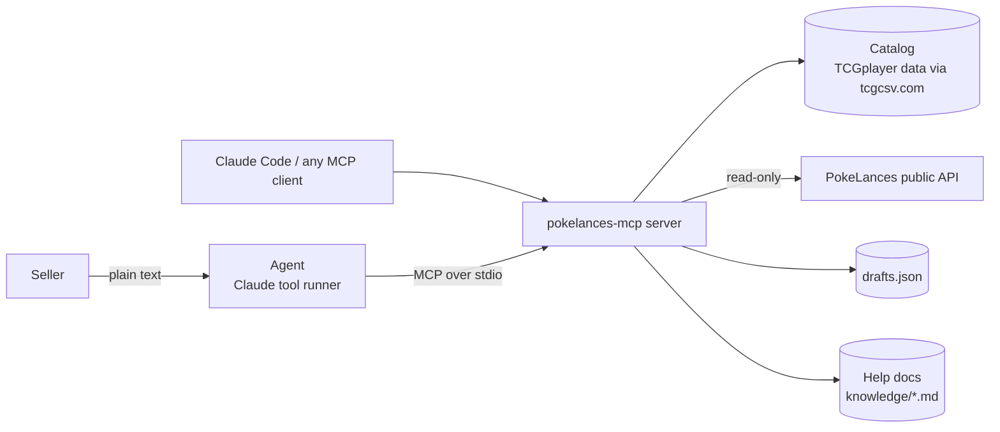

# pokelances-mcp

An **MCP server** and a **Claude agent** that turn a seller's description of their Pokémon TCG cards into listing drafts for [PokeLances](https://www.pokelances.com), a Pokémon TCG marketplace in Peru, plus a small **RAG** that answers buyers' and sellers' questions from the help docs, with citations.

> "Tengo un Charizard ex de 151, el 199, casi nuevo, y 2 Pikachu reverse"
> → finds each card in the catalog, checks whether it is already listed, suggests a price in soles and creates a draft for the seller to review.

## Why

Sellers list cards one by one: look up the exact printing, check the market price, convert it to soles, adjust for condition and make sure it isn't already listed. This project exposes those steps as tools that any MCP client (Claude Code, Claude Desktop, GitHub Copilot…) can use, plus a small agent that chains them.

**The agent never publishes.** It only creates drafts; the seller reviews them and publishes from the store's admin panel.

## How it works



| Tool | What it does | Writes? |
|---|---|---|
| `search_cards` | Search the catalog by name, set (name or code) and collector number. Returns USD market price per sub-type. | No |
| `suggest_price` | USD market × exchange rate × condition factor (NM 1, LP 0.85, MP 0.7, HP 0.5, DMG 0.35), rounded to S/ 0.50. | No |
| `search_store` | Search what is already listed on pokelances.com. | No |
| `create_draft` | Create a draft with the seller's price or the suggested one. Warns about duplicates and prices far from the suggestion. | Drafts only |
| `search_help` | RAG over the help docs: returns the passages that answer a question, with their source, for the model to answer and cite. | No |
| `list_drafts` | List the drafts created so far. | No |

### Guardrails

- **Drafts only, human approval:** nothing reaches the live store without the seller.
- **Idempotency:** `create_draft` takes an `idempotencyKey`; a retried call returns the existing draft instead of creating a second one.
- **Read-only access to the store**, through its public API.
- **Validated inputs:** every tool has a Zod schema; bad arguments come back as tool errors, not crashes.
- **Step limit:** the agent stops after 8 tool-calling iterations and says so.
- **Logged tool calls:** the agent appends every call (tool, arguments, duration, success) to `data/agent-log.jsonl`.
- **stdout belongs to the protocol:** the server logs to stderr only.

## RAG over the help docs

`search_help` answers questions like *"¿cobran más si pago con tarjeta?"* from `knowledge/*.md` (payments, shipping, ways to buy, products, stores).

1. **Chunking:** one chunk per `##` section, with the document title as context and a stable id (`pagos.md#pagar-con-tarjeta`).
2. **Two retrievers:** BM25 for exact terms (*Izipay*, *Shalom*, *NM*) and local multilingual embeddings (`multilingual-e5-base` via Transformers.js: no API key, no cost).
3. **Hybrid score:** a weighted sum of min-max normalized scores (0.8 vectors, 0.2 BM25).
4. **Grounded answer:** the tool returns passages with their source; the model answers only from them, cites them and says so when they don't answer the question.

### Evaluation

`knowledge/eval.json` has 20 paraphrased questions, each with the section that answers it. `npm run eval` measures retrieval, and CI fails if hybrid recall@3 drops below 90%.

| Retriever | recall@1 | recall@3 | MRR |
|---|---|---|---|
| BM25 | 65% | 65% | 0.66 |
| Vectors (e5-base) | 85% | 95% | 0.91 |
| **Hybrid (0.8 / 0.2)** | **85%** | **95%** | **0.91** |

What the numbers taught me:

- **Reciprocal Rank Fusion made things worse here:** 75% recall@3 versus 85% for vectors alone (both with `e5-small`). Any weak one-word BM25 match outranked the best semantic match. A weighted sum of normalized scores fixed it.
- **The embedding model mattered most:** `e5-small` reached 85% recall@3, `e5-base` 95%.
- **On paraphrased questions BM25 adds nothing measurable;** it stays for exact names and codes, which these 20 questions barely use.
- **No similarity threshold:** e5 cosine similarities are compressed (about 0.8 both for answerable and unanswerable questions), so deciding "not in the docs" is left to the answering model, and the tool description tells it to.

The help docs only state what PokeLances does today; anything else (returns, shipping costs) is meant to come back as "I don't have that information".

## Quick start

Requires Node.js 20+.

```bash
npm install
npm run build
npm run sync-catalog            # downloads the Pokémon catalog from tcgcsv.com into data/catalog.json
```

`sync-catalog` options: `--groups 23237,23651` for specific sets, or `--from-cardpulse <raw snapshot dir>` to reuse a raw snapshot from CardPulse, my TCG price pipeline, offline.

### Use it from Claude Code

```bash
claude mcp add pokelances -- node /absolute/path/to/pokelances-mcp/dist/server.js
```

Then ask Claude Code something like *"busca el Charizard ex 199 de 151 y crea un borrador en NM"*.

### Try the tools in a browser

```bash
npm run inspect                 # MCP Inspector
```

### Run the agent

```bash
export ANTHROPIC_API_KEY=...
npm run agent -- "Tengo un Charizard ex de 151, el 199, casi nuevo, y 2 Pikachu reverse"
```

The agent starts the MCP server as a child process, loads its tools with the Anthropic SDK's MCP helpers and runs them with the SDK's tool runner (`claude-opus-5-5`).

### Configuration

| Variable | Default |
|---|---|
| `CATALOG_PATH` | `data/catalog.json` |
| `DRAFTS_PATH` | `data/drafts.json` |
| `STORE_URL` | `https://www.pokelances.com` |
| `USD_TO_PEN` | `3.75` |
| `KNOWLEDGE_DIR` | `knowledge/` |
| `MODEL_CACHE_DIR` | Transformers.js default cache |

## Tests

```bash
npm test
npm run eval      # RAG retrieval eval (downloads the embedding model the first time)
```

Unit tests cover catalog search, pricing, idempotent drafts, store pagination, chunking and BM25. The end-to-end test starts the real server over stdio, talks to it with the MCP client SDK and uses a fake store API, so it never touches the live site.

## Project layout

```
src/
  server.ts        MCP server (stdio)
  agent.ts         Claude agent: MCP client + tool runner
  tools.ts         tool definitions shared by the server
  catalog.ts       in-memory catalog search
  pricing.ts       price suggestion
  store.ts         read-only client for the PokeLances API
  drafts.ts        local draft store with idempotency
  rag/help.ts      chunking, BM25, embeddings and hybrid search
  cli/eval.ts      retrieval evaluation
  cli/sync-catalog.ts
knowledge/                     help docs + eval.json
tests/
fixtures/catalog-sample.json   one set (Scarlet & Violet 151) for tests
```

## Notes

- Prices are a starting point, not an appraisal. The condition factors are configurable rules of thumb.
- Card data comes from TCGplayer through [tcgcsv.com](https://tcgcsv.com). This project is not affiliated with The Pokémon Company, Nintendo or TCGplayer.

## License

MIT
