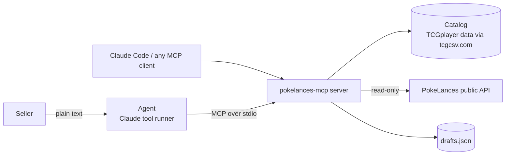

# pokelances-mcp

An **MCP server** and a **Claude agent** that turn a seller's description of their Pokémon TCG cards into listing drafts for [PokeLances](https://www.pokelances.com), a Pokémon TCG marketplace in Peru.

> "Tengo un Charizard ex de 151, el 199, casi nuevo, y 2 Pikachu reverse"
> → finds each card in the catalog, checks whether it is already listed, suggests a price in soles and creates a draft for the seller to review.

## Why

Sellers list cards one by one: look up the exact printing, check the market price, convert it to soles, adjust for condition and make sure it isn't already listed. This project exposes those steps as tools that any MCP client (Claude Code, Claude Desktop, GitHub Copilot…) can use, plus a small agent that chains them.

**The agent never publishes.** It only creates drafts; the seller reviews them and publishes from the store's admin panel.

## How it works



| Tool | What it does | Writes? |
|---|---|---|
| `search_cards` | Search the catalog by name, set (name or code) and collector number. Returns USD market price per sub-type. | No |
| `suggest_price` | USD market × exchange rate × condition factor (NM 1, LP 0.85, MP 0.7, HP 0.5, DMG 0.35), rounded to S/ 0.50. | No |
| `search_store` | Search what is already listed on pokelances.com. | No |
| `create_draft` | Create a draft with the seller's price or the suggested one. Warns about duplicates and prices far from the suggestion. | Drafts only |
| `list_drafts` | List the drafts created so far. | No |

### Guardrails

- **Drafts only, human approval:** nothing reaches the live store without the seller.
- **Idempotency:** `create_draft` takes an `idempotencyKey`; a retried call returns the existing draft instead of creating a second one.
- **Read-only access to the store**, through its public API.
- **Validated inputs:** every tool has a Zod schema; bad arguments come back as tool errors, not crashes.
- **Step limit:** the agent stops after 8 tool-calling iterations and says so.
- **Logged tool calls:** the agent appends every call (tool, arguments, duration, success) to `data/agent-log.jsonl`.
- **stdout belongs to the protocol:** the server logs to stderr only.

## Quick start

Requires Node.js 20+.

```bash
npm install
npm run build
npm run sync-catalog            # downloads the Pokémon catalog from tcgcsv.com into data/catalog.json
```

`sync-catalog` options: `--groups 23237,23651` for specific sets, or `--from-cardpulse <raw snapshot dir>` to reuse a raw snapshot from CardPulse, my TCG price pipeline, offline.

### Use it from Claude Code

```bash
claude mcp add pokelances -- node /absolute/path/to/pokelances-mcp/dist/server.js
```

Then ask Claude Code something like *"busca el Charizard ex 199 de 151 y crea un borrador en NM"*.

### Try the tools in a browser

```bash
npm run inspect                 # MCP Inspector
```

### Run the agent

```bash
export ANTHROPIC_API_KEY=...
npm run agent -- "Tengo un Charizard ex de 151, el 199, casi nuevo, y 2 Pikachu reverse"
```

The agent starts the MCP server as a child process, loads its tools with the Anthropic SDK's MCP helpers and runs them with the SDK's tool runner (`claude-opus-5-5`).

### Configuration

| Variable | Default |
|---|---|
| `CATALOG_PATH` | `data/catalog.json` |
| `DRAFTS_PATH` | `data/drafts.json` |
| `STORE_URL` | `https://www.pokelances.com` |
| `USD_TO_PEN` | `3.75` |

## Tests

```bash
npm test
```

Unit tests cover catalog search, pricing, idempotent drafts and store pagination. The end-to-end test starts the real server over stdio, talks to it with the MCP client SDK and uses a fake store API, so it never touches the live site.

## Project layout

```
src/
  server.ts        MCP server (stdio)
  agent.ts         Claude agent: MCP client + tool runner
  tools.ts         tool definitions shared by the server
  catalog.ts       in-memory catalog search
  pricing.ts       price suggestion
  store.ts         read-only client for the PokeLances API
  drafts.ts        local draft store with idempotency
  cli/sync-catalog.ts
tests/
fixtures/catalog-sample.json   one set (Scarlet & Violet 151) for tests
```

## Notes

- Prices are a starting point, not an appraisal. The condition factors are configurable rules of thumb.
- Card data comes from TCGplayer through [tcgcsv.com](https://tcgcsv.com). This project is not affiliated with The Pokémon Company, Nintendo or TCGplayer.

## License

MIT
